# Designing Terminal Color Schemes

> *Well selected colors are the 1st step in making a terminal look beautiful. The 2nd step is to use Meslo font, or thats at least what a color scheme designer would say...*

---

## Terminal Color Scheme Tools

I so far have had good luck starting with root loops and then finishing schemes in terminal.sexy.

- [rootloops.sh](https://rootloops.sh) - Good starting point for basic color combinations as it works with a HSL based color coordination scheme.
- [terminal.sexy](https://terminal.sexy) - Good for refining existing schemes

When designing with either of the above tools, make sure to *export in :* `ghostty` format for use within Termux. Then do quick find/replace

`palette = ` to `cok`

## Termux Themes are Stored in the `.termux/colors` folder

```
$HOME/dotfiles/termux/colors
```

Then in the `premade` or `custom` directory. Themes can be symlinked from these folders to the `favorites` folder to keep a curated collection. The `premade` folder is just a symlink to the Termux:Styling Plugin Colors Directory.

### Loading in Premade Themes from *Termux:Styling Plugin*

The *Termux:Styling* Plugin is imported into this repo as a submodule. It's cloned into the `.submodules` directory. The relative symlink already exists, linking the `colors/premade` directory to `../.submodules/termux-styling/app/src/main/assets/colors`. Make sure when you `clone` this repository to use `--recurse-submodules` flag.

## Change Theme (w/Preview)

First declare the `$scheme` variable

```
scheme=colors/<premade|custom|favorites>/<theme.name.properties>
```

> ___Note:__ You can `tab` the path after the `=`. 

Then run `./bin/colorscheme.sh`. You can also set the color scheme path as a parameter to the `colorscheme.sh` like so:

```
./colorscheme-set.sh colors/custom/dark.colorscheme.properties
```

---

## Custom Themes

themes in the `colors/custom` directory. All themes are prepended with `light.` or `dark.` depending on type of color scheme.

### 2cyan

A medium contrast and over saturated with the colors piched towards a cyan blue

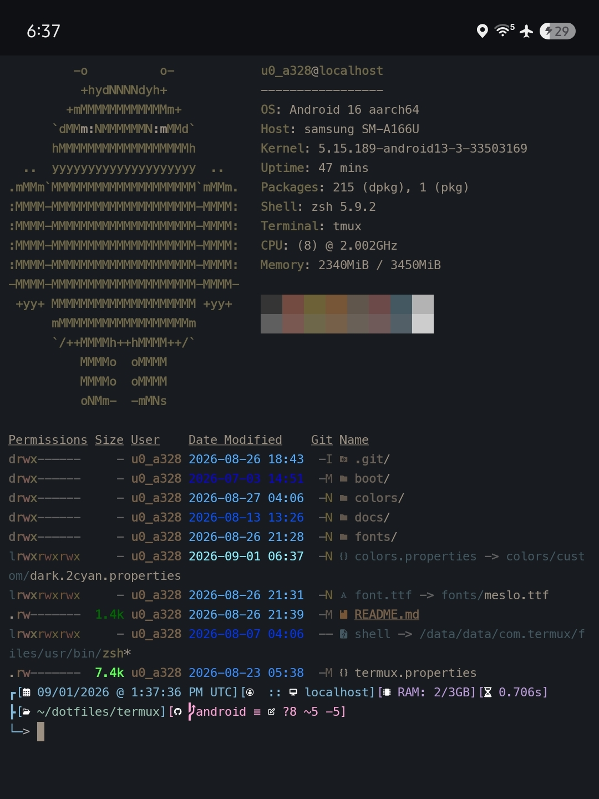

path: `colors/custom/dark.2cyan.properties`

### astromoose

A woody 1950's national park feeling theme. Even pitched natural colors.

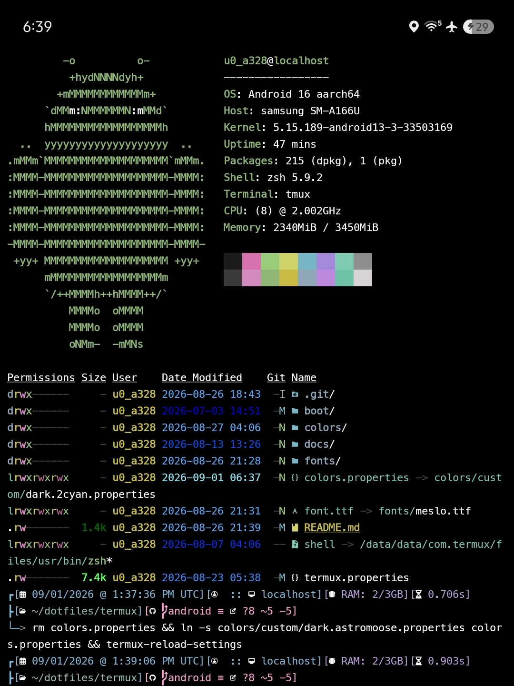

path: `colors/custom/dark.astromoose.properties`

### dawn

An burnt orange theme with under saturated colors resemblent of sun rise. Colors pitched orange.

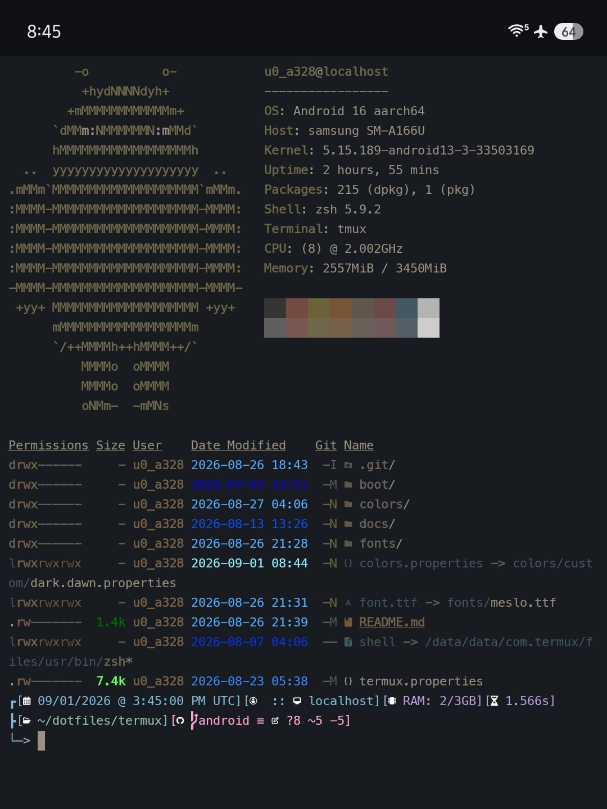

path: `colors/custom/dark.dawn.properties`

### neon

A high contrast / high saturation theme resemblent of neon lights on a dark night. Even pitched colors. Built off of the new gnome theme. 

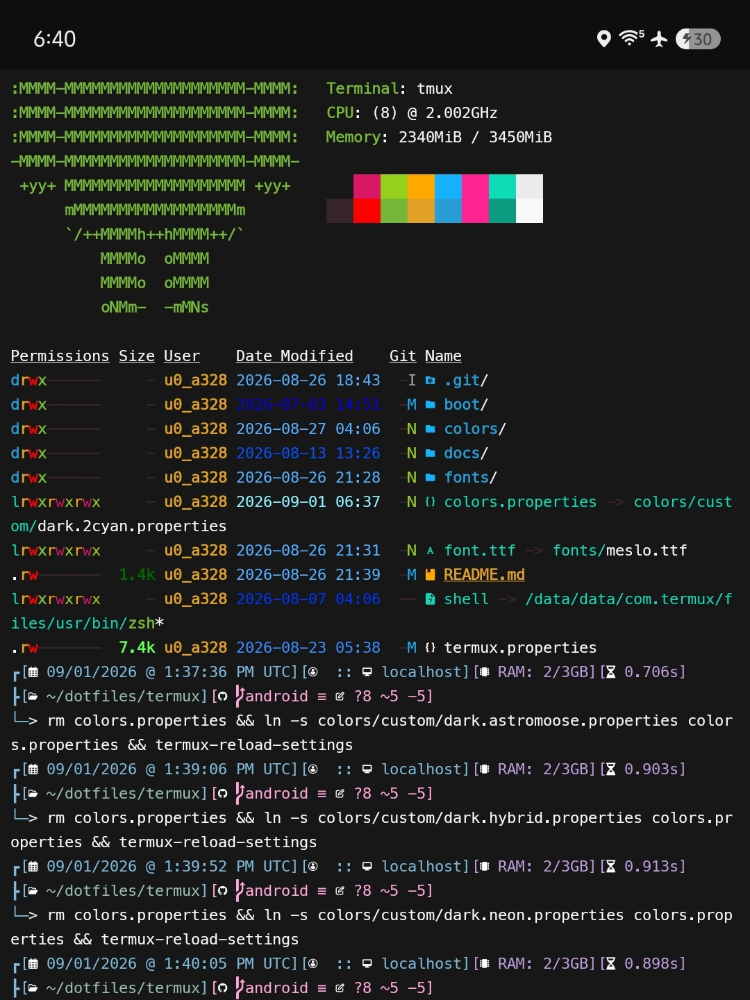

path: `colors/custom/dark.neon.properties`


### hybrid

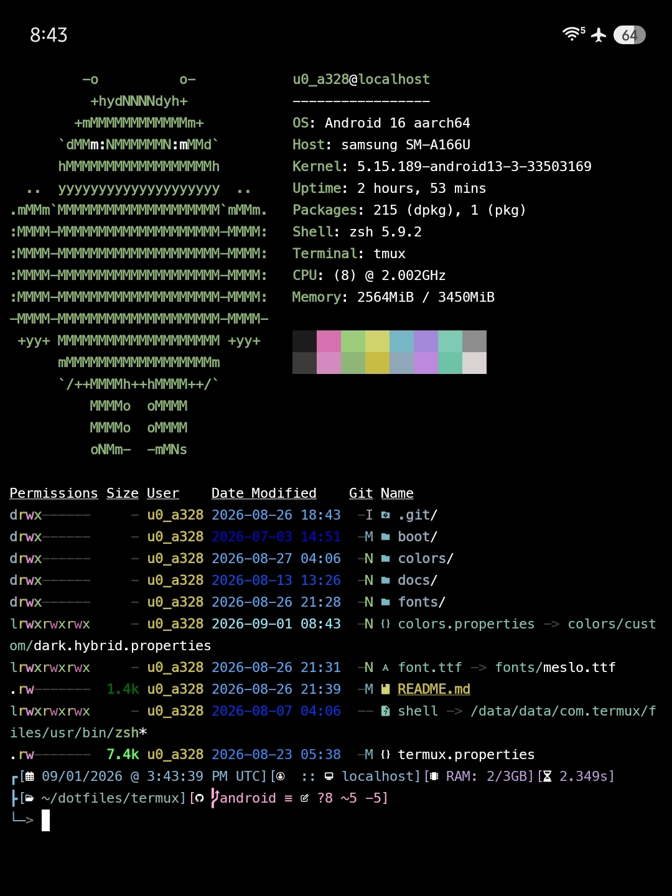

path: `colors/custom/dark.hybrid.properties`

### kasugano

A meduim contrast theme with the colors pitched red

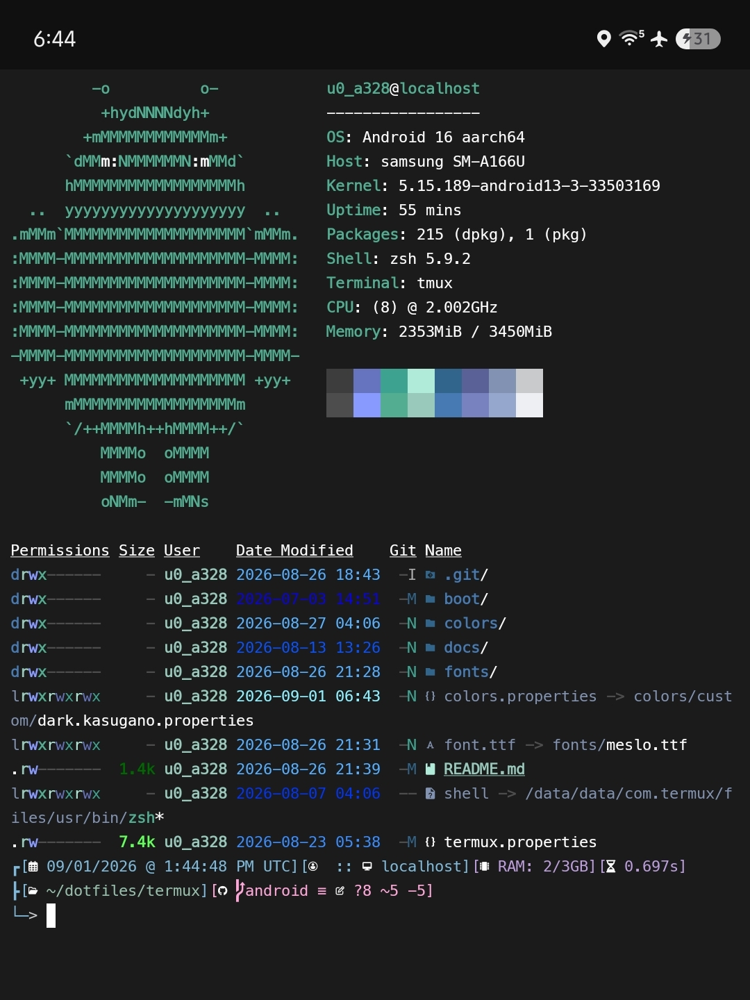

path: `colors/custom/dark.kasugano.properties`

---

## Premade Themes

themes in the `colors/premade` directory. (yanked from termux styling)

### gnometerm-new

The new Gnome terminal theme. High contrast / high saturation / even pitch. 

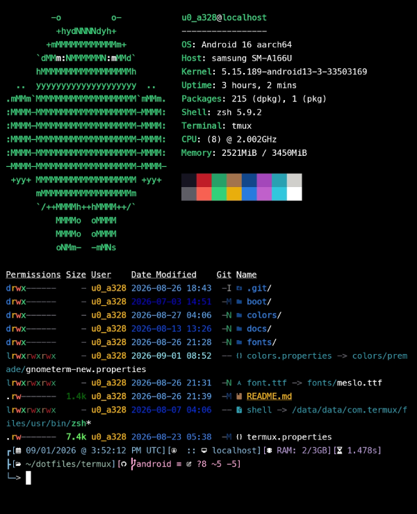

path: `colors/premade/gnometerm-new.properties`

### gnometerm

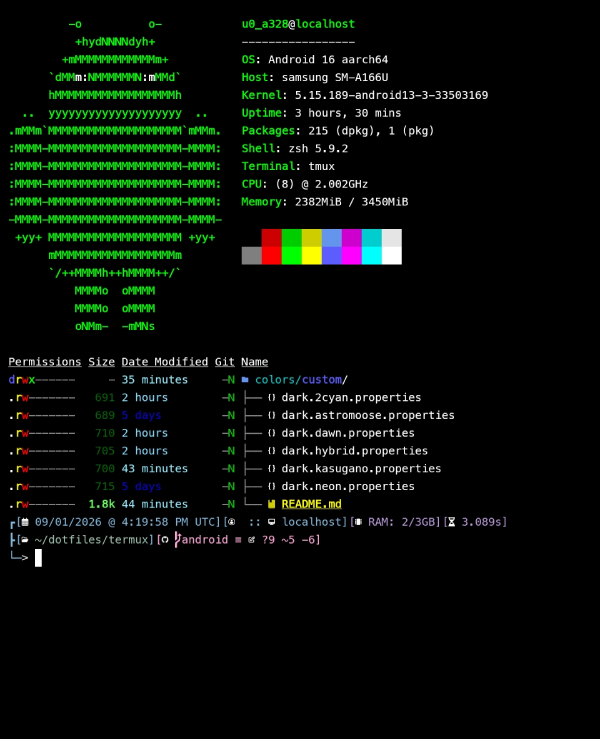

path: `colors/premade/gnometerm.properties`

### iceberg

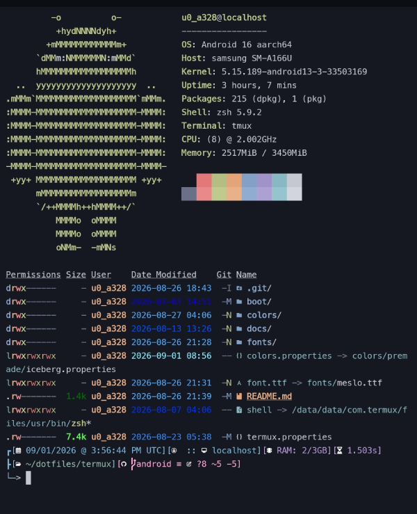

path: `colors/premade/iceberg.properties`


### material

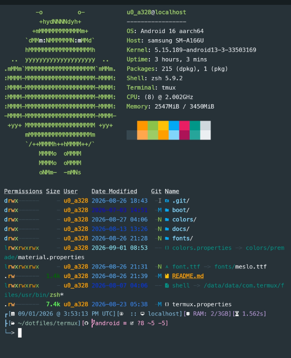

path: `colors/premade/material.properties`


### nancy

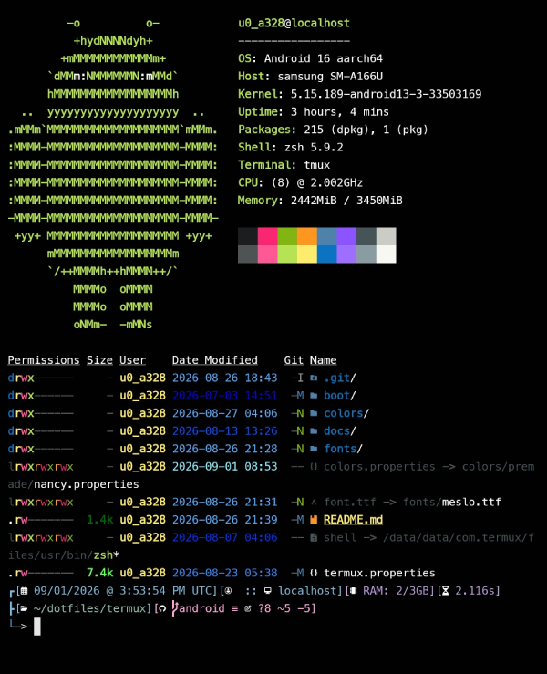

path: `colors/premade/nancy.properties`

### nord

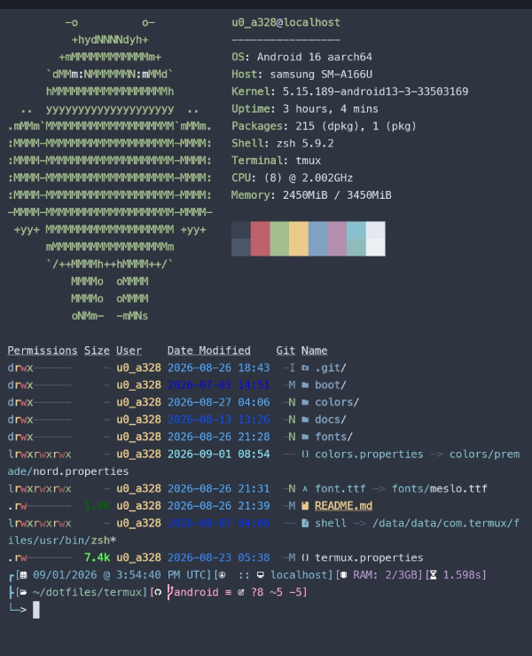

path: `colors/premade/nord.properties`

### rosé-pine-moon

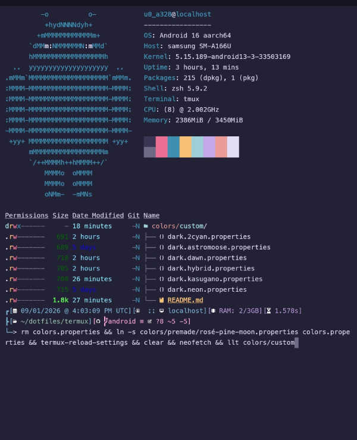

path: `colors/premade/rosé-pine-moon.properties`

### rydgel

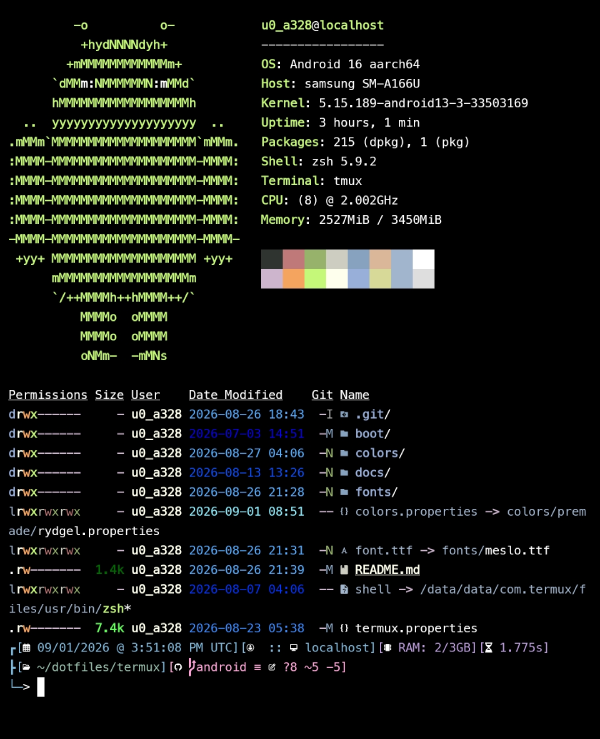

path: `colors/premade/rydgel.properties`

### smyck

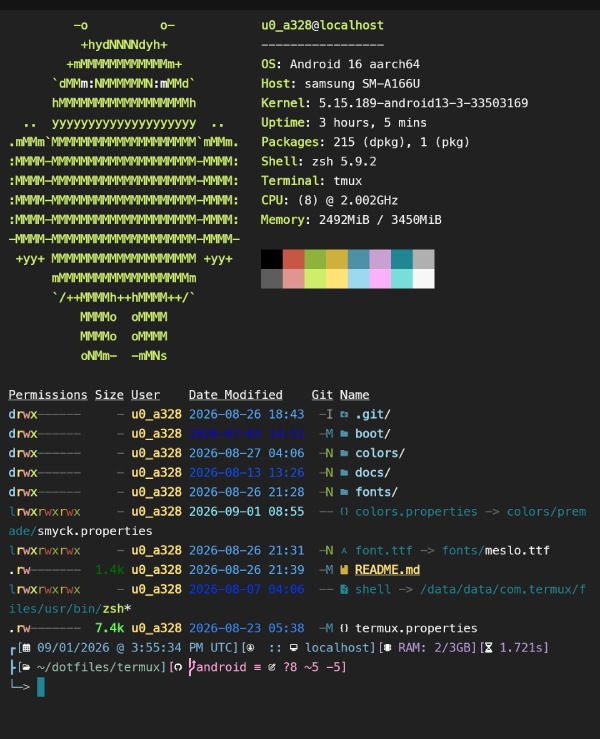

path: `colors/premade/smyck.properties`

### ubuntu

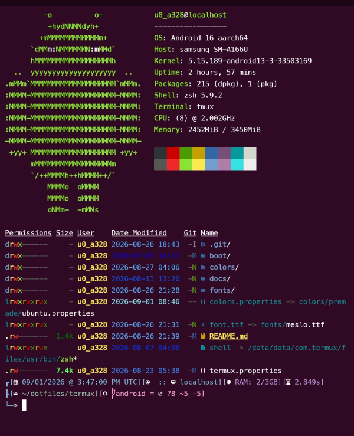

path: `colors/premade/ubuntu.properties`

### zenburn

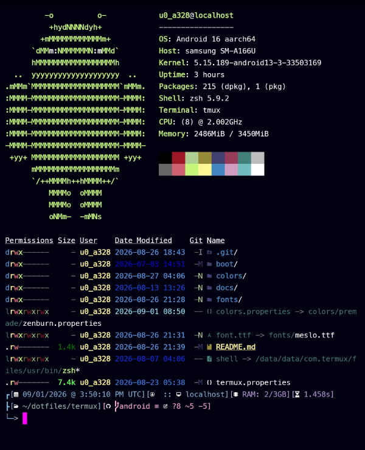

path: `colors/premade/zenburn.properties`

